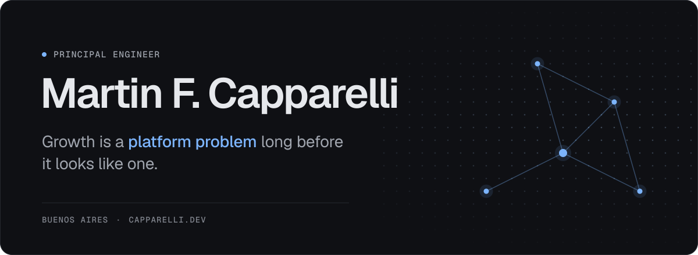
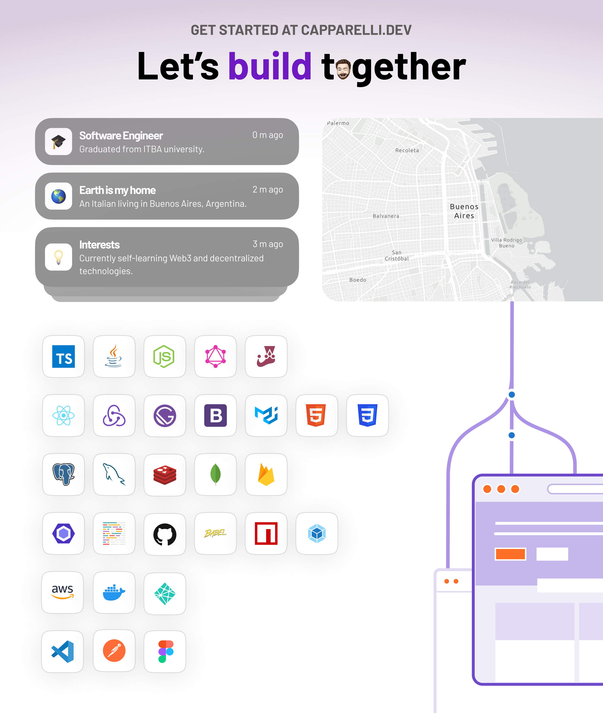

<<<<<<< HEAD

I build platforms, and I care about how software behaves once it's running: how fast it can change without losing control, how simple it is to operate, and what it costs.

Lately I've been thinking about git workflows, platform design, and what AI changes for the people who build software. 

#### Recent writing

- **[Cognitive Debt](https://www.capparelli.dev/blog/cognitive-debt)**  `NOV 2026`  
  When knowledge of the system lives in people, and now in AIs, instead of in the system.
- **[An Opinionated Git Workflow](https://www.capparelli.dev/blog/an-opinionated-git-workflow)**  `SEP 2025`  
  Keep main as the source of truth and let teams move fast without chaos.
- **[AI Agents: My First Mission](https://www.capparelli.dev/blog/ai-agents-my-first-mission)**  `JUL 2025`  
  Directing a crew of AI agents to restyle a site, and what actually happened.

 

[capparelli.dev](https://www.capparelli.dev)  ·  [LinkedIn](https://www.linkedin.com/in/mfcapparelli/)  ·  [Writing](https://www.capparelli.dev/blog)
=======

  

  <h2>You can also find me</h2>
  
  <a href="https://www.capparelli.dev">Website</a>
  &nbsp;&nbsp;•&nbsp;&nbsp;
  <a href="https://medium.com/@martincapparelli">Medium</a>
  &nbsp;&nbsp;•&nbsp;&nbsp;
  <a href="https://www.linkedin.com/in/martin-federico-capparelli-49b38797/">LinkedIn</a>
  
   

>>>>>>> 5587013d0beac844cdd141bdcc85c06da166278b
